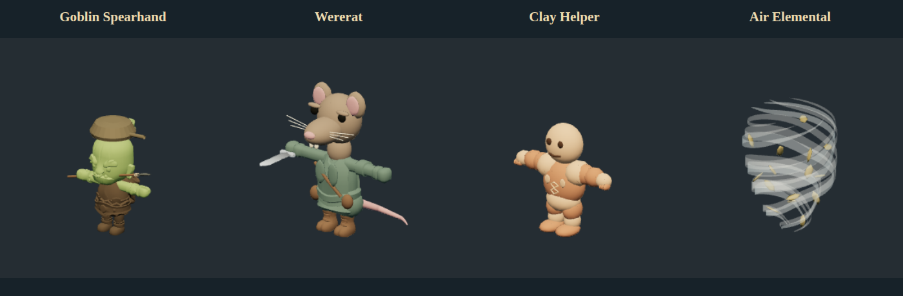

# First creature model pilots — November 10, 2026

The first batch changes **Goblin Spearhand, Wererat, Clay Helper and Air Elemental**. It changes appearance and animation selection, not printed stats, abilities, AI, XP, encounter budgets or saved creature IDs. Existing journeys use the new appearances automatically. No respec is needed.



## What changed

- **Spearhand:** authored leaf-headed spear and saucepan helmet; the spear attacks use the existing thrust clip rather than the sword slash. The shared humanoid spear renderer also fixes Hobgoblin Shieldguard's weapon. Animated Statue remains on its old nonhumanoid cast and is not fixed by this batch. The goblin's body remains the small Orc Raider proxy; this batch does not claim to fix goblin anatomy.
- **Wererat:** a long-muzzled rat head, rounded ears, dark eyes, whiskers, incisors, skin-colored tail, coat lapels/pouches and cross-body strap replace the human lumberjack cast. Retains the existing humanoid skeleton/clothing weights, adds four weighted tail bones and idle/walk tail sway, and uses a smaller held blade. It is still a stylized chibi thief, not a detailed furry rat hybrid.
- **Clay Helper:** a grounded, articulated terracotta/unfired-clay humanoid with broad palms, blunt fingers, recessed eyes, a mouth seam and maker seal replaces the floating winged Goleling. It reuses the working humanoid animation skeleton. Smooth segmented shapes remain simpler than the hand-sculpted book reference.
- **Air Elemental:** a hollow tapering vortex of seven translucent wind ribbons and orbiting leaves replaces the skull ghost. Continuous swirl, hover/travel, attack pulse, recoil and collapse animate it. It is geometry-driven wind, not volumetric smoke/fluid simulation; the ribbon structure remains visible.

Original input GLBs remain unchanged. Five new runtime exports and editable Blender files have a reproducible builder. Source donor license, hashes and triangle/skin metadata are in [provenance](creature-pilots-provenance.json). There are no new purchases, cloud generations or paid source exports.

## Same-rubric reassessment

These remain single-agent editorial ratings, not player approval or measured similarity percentages. The [58-entry baseline](audits/2026-11-10-creature-fit.md) is preserved; [new component scores](audits/2026-11-10-creature-pilots.json) cover only these four. Do not read them as a new complete-roster average.

| Creature         | Before | Pilot | A/S/F/G/M/D | Remaining gap                                                             |
| ---------------- | -----: | ----: | ----------- | ------------------------------------------------------------------------- |
| Goblin Spearhand |     41 |    66 | 3/3/2/5/3/5 | Orc anatomy; simple hat and stock costume.                                |
| Wererat          |     19 |    77 | 4/3/4/4/3/5 | Fur, rat posture and more convincing coat/hand details.                   |
| Clay Helper      |      9 |    76 | 4/3/3/5/3/5 | Organic clay surface, less bead-like silhouette and stronger hand detail. |
| Air Elemental    |     11 |    85 | 5/4/3/5/3/5 | More organic cloud/dust breakup and softer ribbon edges.                  |

Score = 6A + 3S + 4F + 3G + 2M + 2D. No score has been inflated to meet an 80-point target. These improve identity and establish a working local authoring pipeline; the overall high-end art goal remains open. Bruce's visual feedback should guide the next refinement before broad conversion to this style.

## Verification

- 358 unit tests pass, including spear thrust selection with sword/default fallback unchanged.
- Blender export/reimport inspection: Wererat **6,490 triangles / 27 bones**, Clay Helper **2,800 / 23 bones**, Air Vortex **1,546**, spear **1,492**, saucepan **412**. New skinned meshes have no unweighted vertices or zero-area faces. Blender bone display helper meshes are excluded from the runtime count. Air has eight meshes/three materials; draw-call cost depends on mesh/material groups. Native gameplay draw calls were not benchmarked.
- Browser and actual packaged `launch-game.sh` checks exercise all four pilots with distinct poses and finite world-space coordinates for every rendered vertex in idle/walk/attack/hit/death; attachment/tail node presence and skull-free wind are checked; grip placement and sway were visually inspected, not certified by the node-name assertions. Native gallery covers all 58 creature adapters and 17 condition layers. Screenshots were inspected. Tests use isolated saves and retain the normal terminal AppArmor context, seccomp and sandboxing.
- Magic weapon appearance/save/reload native regression passes separately; creature AI native checks also passed in the earlier combined attempt before that window closed unexpectedly. No passing claim is made for that aborted combined run.
- QA discovered and corrected a short/occluded spear grip, a rat neck gap, zero-width ribbon tips and extra draw calls from separate generated parts. The pose test initially compared local vertices and missed object-transform motion; it now compares world-space geometry rather than relaxing the motion assertion. One earlier native attempt closed unexpectedly during weapon reload; the isolated weapon regression and scoped creature run subsequently passed.
- Local directory build includes the pilots; the installed system package/public v0.8.7 release is unchanged. This is not a new release or Windows native qualification.

Neutral inspection-render counters (including held gear) are 11/8/4/15 draw calls and 7,753/6,790/2,800/2,792 submitted triangles for Spearhand/Wererat/Clay/Air. Transparent two-sided wind contributes extra passes; these are standalone inspection counters, not a full-dungeon performance benchmark.

Runtime testing is **muted** by default, as Bruce requested. Native/release QA pass Chromium's `--mute-audio`; the native harness checks that flag. Personal saved audio settings and desktop master volume are untouched.

## Reproduce and inspect

```sh
blender --background --factory-startup --python scripts/toolchain/build_creature_pilots.py
```

The builder only clears its own new Blender process, preserves the donor, and writes the five named `.blend`/GLB outputs. Rebuilding requires refreshing provenance hashes and reassessing screenshots; Blender binary output hashes are not guaranteed byte-identical across runs/platforms. New geometry is joined deliberately by equal rig/material requirements, without welding or decimating original character geometry.

Use `AUDIT_IDS` and `AUDIT_RATINGS` to capture a subset against its new ratings:

```sh
# Start npm run dev -- --port 5187 separately.
AUDIT_IDS=creature-goblin-spearhand,creature-wererat,creature-clay-helper,creature-air-elemental \
AUDIT_RATINGS=docs/audits/2026-11-10-creature-pilots.json \
AUDIT_OUT=test-results/creature-model-pilots node scripts/creature-fit-capture.mjs
```

The local `comparison.html` includes book/front/rear views and fixed review scores. `game-{idle,walk,attack,hit,death}.png` captures the actual-game fixture. These QA outputs are ignored; the model-only lineup and authored sources travel in Git. Source-book illustration rights remain unchanged.

A bounded read-only DeepSeek worker reviewed provenance, the inspector, pose check and report. Its useful findings led to all-vertex/distinct-state checks, N/A weight metadata for unskinned assets and explicit material counts/measurement limits. It did not review art/images or independently rerun native QA; source test/security evidence lives in the main harness and logs, outside its four supplied files.
