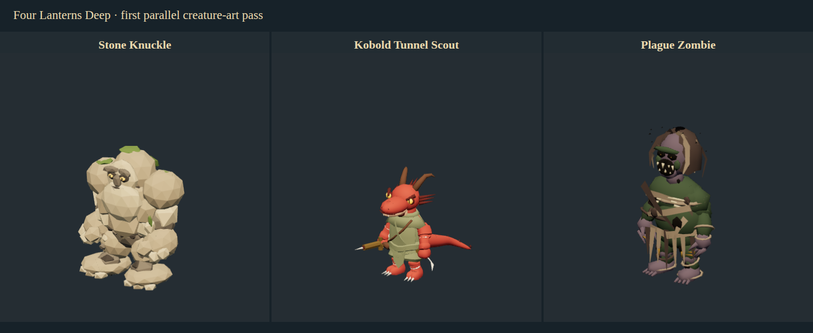

# Parallel creature models — wave 01

November 10, 2026. Base `1244c0a`, branch `codex/deepseek-creature-wave-01`. Bruce requested parallel DeepSeek model authors with GPT assigning, reviewing and returning revisions. Three actual DeepSeek Flash Codex CLI workers authored separate creatures concurrently; GPT inspected their scripts/exports, judged renders, requested one zombie revision and integrated accepted work. No built-in GPT subagent is being presented as a DeepSeek worker.

## What changed

| Creature            | Replaced proxy        | Authored first pass                                                                                                | Triangles / materials / bones | Fit before → now |
| ------------------- | --------------------- | ------------------------------------------------------------------------------------------------------------------ | ----------------------------- | ---------------- |
| Stone Knuckle       | Winged/floating golem | Grounded boulder core, broad pebble fists, planted feet, moss and contrasting amber eyes                           | 2,940 / 6 / 23                | 6 → 83           |
| Kobold Tunnel Scout | Orc                   | Reptilian head, eyes, horns/ridges, clawed feet, four-joint tail, scout clothing, launcher, chalk/twine and ribbon | 5,956 / 8 / 27                | 14 → 77          |
| Plague Zombie       | Healthy human costume | Corpse flesh, dark eye/mouth recesses, hooked claws, ragged partial hood and burial strips                         | 3,060 / 7 / 23                | 23 → 73          |

These are editorial six-part identity scores from the existing audit rubric, not similarity percentages or final art approval. Stone meets the pipeline's 80-point target; kobold and zombie are accepted for recognizable coverage with explicit remaining gaps. The historical 58-creature baseline is unchanged; no new full-roster average is claimed. Component scores/rationale: [wave ratings](audits/2026-11-10-creature-wave-01.json).

The original CC0 Ninja rig remains intact. Stone and zombie replace its visible geometry; kobold retains/adapts the donor body/rig and adds new anatomy, clothing and props. Existing shared game clips animate all three; kobold tail sway uses the same supplemental callback as the wererat. Creature IDs, encounters, stats, abilities and saves are unchanged. [Provenance](creature-wave-01-provenance.json) records paths, exact hashes, counts and licensing. Editable `.blend` files and [portable builders](../scripts/toolchain/creature-workers/README.md) are retained. No paid/cloud-generated meshes or source-book/Foundry edits.

## Review and revision

Stone and kobold passed organizer review after their own self-checks. The first zombie submission looked like a pale clean mummy and its head appeared detached in shared poses. GPT returned actual Three.js render evidence and specific changes: a connected neck, exposed corpse flesh, sparse irregular cloth, partial hood, severe face and corrected color conversion. The DeepSeek revision addressed these; front/side/back and all five game poses were rendered again before acceptance.

Remaining art work: stone needs more varied stone scale and less toy-like symmetry; kobold needs narrower proportions, better garment/grip detail and richer scales; zombie needs more gaunt organic anatomy, convincing shroud folds and mottled surface detail. All use flat color materials without baked textures, so texture image memory is zero. Actual neutral model render calls are 6/8/7; triangle count alone is not the full rendering cost. Rigidly weighted assembled forms still need targeted refinement beyond the five required shared clips. No claim that these are bespoke creature animation sets.

## Verification

- All three portable Blender builders rerun successfully from the checkout, producing **byte-identical GLBs** to the accepted worker exports. Source donor hash remains unchanged. Worker GLB reimport inspections report zero unweighted vertices, zero-area faces or loose vertices.
- Organizer's `review_asset_submission.mjs` separately loads embedded GLBs with Three.js and the actual shared game animation library. Idle, walking, attack, hit and death yield distinct poses with finite world-space coordinates for every rendered vertex. No animation-binding warnings. Front/side/back/three-quarter and pose sheets inspected; neutral lighting does not stand in for dungeon lighting.
- Actual appearance-factory reference/front/rear capture passes for the three exact creature IDs and validates the rating totals. Evidence remains ignored under `test-results/creature-wave-01/`; the committed lineup contains models only.
- **358 unit tests pass.** `npm run package:dir` refreshes the checkout launcher. Native checks pass through `launch-game.sh` under terminal-matching AppArmor with sandboxing enabled and `--mute-audio`: all seven authored pilot creatures, five poses, all 58 creature adapters, all 17 condition layers, isolated disk save and window-close handshake.
- Initial seven-model screenshots placed some actors outside current party vision. The check was corrected to a compact layout, verifies actual group visibility, restores camera settings and was rerun successfully; final screenshots show all seven. This was a test-scene issue, not a game visibility rule change.
- Worker wrapper syntax and fake-worker descendant-cleanup smoke check pass without an extra API call. It was added after the live jobs; a live run of that exact new wrapper is still untested. Initial direct jobs exposed Blender shutdown hangs, which are documented in [worker process](asset-worker-process.md).

Native evidence logs on this machine: `/tmp/fld-wave01-native.log` and `/tmp/fld-wave01-native-pilots.log`. Raw job transcripts/rejected renders remain under `~/.local/share/four-lanterns-workers/2026-11-10-wave-01/`, outside Git. They include three completed authoring runs and one completed revision run. API usage is recorded locally; no dollar-cost estimate or broad model-performance benchmark is inferred from this one wave.

The checkout launcher includes this content while retaining version label **0.8.7**. Installed system package and public release are unchanged; no release was requested. Linux native interaction was checked here. Windows installer build is delegated to repository CI, and Windows desktop interaction has not been tested in this session.
