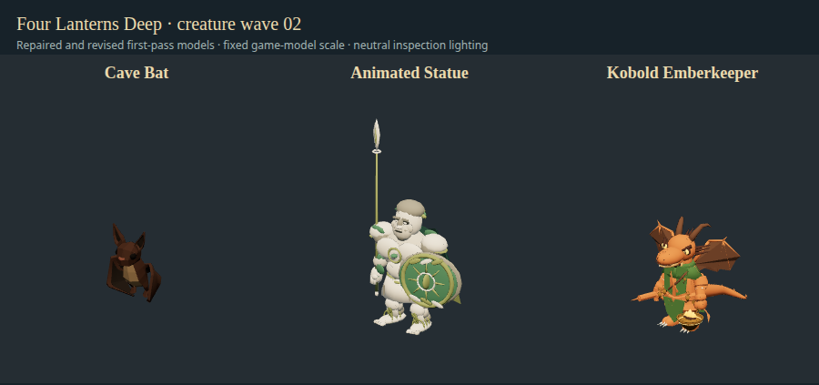

# Lowest-rated creature models — wave 02

November 10, 2026. Base `4f52b62`, branch `codex/deepseek-creature-wave-02`. Bruce requested another parallel DeepSeek batch from the lowest remaining fit ratings, with organizer review and return for changes. Three DeepSeek CLI authors ran concurrently in isolated jobs through the bounded worker runner. GPT reviewed each submission and returned four revision jobs: bat palette, statue spear, emberkeeper hanging gear/wings, then emberkeeper chain length. All seven calls completed successfully; no active API worker remains.

| Creature           | Before → now | Concrete result                                                                                       | Export triangles / unique materials / bones | Actual neutral draw calls |
| ------------------ | ------------ | ----------------------------------------------------------------------------------------------------- | ------------------------------------------- | ------------------------- |
| Cave Bat           | 0 → 78       | Visible bat with natural fur/chest/membrane palette, original rig and five embedded clips preserved   | 1,038 / 1 / 28                              | 5                         |
| Animated Statue    | 2 → 80       | Carved civic guardian, face/laurel, mantle, shield and upright ceremonial spear                       | 11,060 / 8 / 23                             | 8                         |
| Kobold Emberkeeper | 9 → 80       | Copper reptilian keeper, ceremonial clothing, ribbed/scalloped wings and suspended coal/flame brazier | 10,234 / 8 / 29                             | 11                        |

Scores use the existing weighted six-part editorial identity rubric, not measured similarity percentages or final art approval. [Component scores and rationale](audits/2026-11-10-creature-wave-02.json). The historical full-roster audit and its old average remain untouched. These were the lowest three remaining entries after previous accepted pilots/wave 01; this does not complete all 58 models.

## Findings and revisions

**Bat:** the original embedded 32×4 RGBA palette had alpha zero for all 128 pixels while its material used alpha masking. The organizer reproduced **zero rendered model pixels** across eight neutral views/poses despite valid animated bounds. The worker repaired palette opacity/material mode, preserving the mesh, nodes, skin, rest transforms and animation payloads. Its first repaired export was purple with a bright yellow chest; organizer review returned this for a restrained umber/taupe/charcoal palette. Final front coverage is 29,522 pixels in the same inspection setup. Raster coverage establishes visibility only, not anatomy or final art quality.

The original file is unchanged. Organizer comparison verifies identical nodes/skins/animation metadata and every non-image binary buffer payload. All five original embedded clips remain. Idle and movement deliberately share `Bat_Flying`, so there are four distinct sampled poses across the five requested states; no new flight clip is claimed. Native flying, attack, hit and death were inspected. Fur, leaf-nose detail and hooked feet remain angular/simplified.

**Statue:** initial shared-animation review found a wrongly oriented spear; the worker's final self-correction then pointed it down through the floor. Organizer supplied the actual inverse posed-hand direction, returned the spear for a +X rest-axis correction, and requested a properly pointed leaf-shaped blade. Revised idle/walk/thrust/hit/death pass. Runtime uses the authored spear/shield instead of attaching a duplicate generic spear. The figure remains chunky with simple face anatomy, mantle folds and surface weathering.

**Emberkeeper:** first submission had triangular glider-like wings and a hand-skinned brazier that pointed sideways like a blowtorch. First revision added scalloped/ribbed membranes, stronger ceremonial clothing, and an unskinned `HangingBrazier` node parented at the hand grip. Organizer's runtime stabilizer preserves hand position while keeping the cup upright. Second revision shortened the suspension from 0.861 to 0.446 local units so normal idle does not put it through the floor. The rigid cup rests above the actor's floor when extreme hit/death poses lower its hand. This is a geometric contact adjustment, not a physical chain simulation. Tail sway is retained; wing flap/folding and rigid tail clipping in extreme death poses remain later refinement work. Flames are emissive modeled shapes, not simulated fire or a new gameplay light source.

## Sources and reproducibility

[Provenance](creature-wave-02-provenance.json) records exact unchanged donor/output hashes, editable sources, builders and counts. Statue uses the CC0 KayKit Ninja rig; emberkeeper uses the project's accepted CC0-derived Kobold Scout; bat repairs/recolors the existing CC0 Quaternius asset. No downloaded/new paid assets, generator account, source-book/Foundry edits or assigned public license for project-original contributions.

All three [portable builders](../scripts/toolchain/creature-workers/README.md) rerun successfully with Blender 5.2.4 LTS. Bat and emberkeeper GLBs are byte-identical to accepted submissions. Statue's JSON, all vertex attribute/bind buffers and oriented triangle sets match; some index triplets are reordered by Blender, so its rebuild is structurally/render-equivalent rather than byte-identical. No repeated rebuilding was used to force a matching hash.

GLB file meshes / Three.js render meshes are respectively 2/5, 1/8 and 2/11; material primitives can become separate draw calls. Static eyes/brazier have no skin and are reported as unskinned rather than unweighted failures. All genuinely skinned vertices have weights; reimport reports zero loose vertices or zero-area faces. Bat retains one embedded 32×4 texture (512 decoded RGBA bytes before mipmaps/driver overhead); statue and emberkeeper have no textures. These are measured per-model inspection costs, not full-game frame costs.

## Verification and limits

- **358 unit tests pass** and `npm run package:dir` refreshes the checkout launcher.
- Separate Three.js review supports shared humanoid, spear-thrust and embedded creature clips. It records actual rendered-pixel coverage and finite world-space geometry for every vertex, with front/side/back/three-quarter and animation screenshots. The original bat deliberately fails this visibility check; all accepted exports pass.
- Actual appearance-factory before/after captures use the same fixed game-model scale; final ratings are validated. Ignored evidence under `test-results/creature-wave-02-{before,after}/` and `test-results/worker-review/wave02-*`.
- Native muted `launch-game.sh` under terminal-matching AppArmor/SUID sandbox passes ten updated-creature adapters, baseline idle/move/attack/hit/death, emberkeeper spellcast, all 58 creature adapters and 17 condition layers, isolated disk save and window-close handshake. No sandbox-disabling flag. Logs `/tmp/fld-wave02-native.log` and `/tmp/fld-wave02-native-pilots.log`.
- Screenshot review caught an entrance prop obscuring the emberkeeper and a test bug that measured the hanging group instead of its mesh children. The test scene was cleared/repositioned; finite measured cup bounds and uprightness now assert across all six emberkeeper poses. Corrected checks were rerun and all ten are unobscured in final captures. This is organizer QA, not independent review.
- The bounded runner's exact live authoring and revision paths are now exercised, not just the earlier fake-worker smoke. Jobs exited zero with no timeout or remaining task-owned Blender process. Raw transcripts/rejected renders stay local under `~/.local/share/four-lanterns-workers/2026-11-10-wave-02/`.

Installed package/public release remain unchanged; checkout build remains labeled 0.8.7. No release was requested. Windows packaging/desktop interaction were not run for this wave. PR CI checks rules and the browser build. High-end surface detail and bespoke creature motion remain separate refinement work; passing these checks does not imply those are finished.

Next lowest remaining candidates: Cinder Strider (11), Kobold Trapkeeper (14), Emberling (16), subject to checking newer accepted scores before assigning the next batch.
