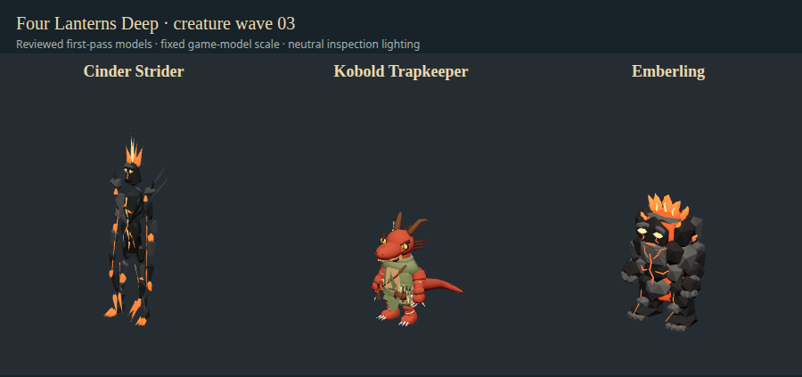

# Fire elementals and trap specialist — wave 03

November 10, 2026. Base `50c18fe`, branch `codex/deepseek-creature-wave-03`. Bruce requested Cinder Strider, Kobold Trapkeeper and Emberling through parallel DeepSeek workers with organizer review/returned changes. Three concurrent authors and one requested revision per creature completed through the bounded runner. GPT reviewed scripts, canonical rig data, actual exported pixels/poses, materials and native game behavior before integration. This is author/organizer review, not independent review.

| Creature          | Editorial fit before → now | Result                                                                                      | Triangles / materials / bones | Actual neutral draw calls |
| ----------------- | -------------------------- | ------------------------------------------------------------------------------------------- | ----------------------------- | ------------------------- |
| Cinder Strider    | 11 → 81                    | Tall narrow charcoal/fire body, long heated limbs, orange fissures/crown and shoulder smoke | 2,036 / 7 / 23                | 12                        |
| Kobold Trapkeeper | 14 → 78                    | Reptilian specialist, dart/case, tool roll/pliers, marked cord coil and patched tan apron   | 7,739 / 8 / 27                | 16                        |
| Emberling         | 16 → 85                    | Compact coal body, crack eyes, orange seams and visible layered flame crown                 | 3,104 / 7 / 23                | 17                        |

[Scores/rationale](audits/2026-11-10-creature-wave-03.json) use the existing six-part identity rubric, not similarity percentages or final art approval. Trapkeeper remains below the target 80: its specialist gear is readable but its chunky Scout-derived body/mitten grips still need refinement. Strider smoke is restrained and angular; both elementals have rigid/faceted fire shells rather than simulated flame. No historical full-roster average is rewritten and the remaining roster is unfinished.

## Review and returned work

**Strider:** the first worker overlooked the supplied Ninja path and reconstructed a similarly named rig. That submission was rejected despite passing finite-geometry checks. Organizer pointed to the existing donor and required direct canonical import, plus charcoal/orange material separation instead of pale yellow heat and brown plates. The revision imports/hash-checks the actual source and uses a deliberate outer presentation scale to retain the tall silhouette. Original named local-rest components agree within about 1.1e-5 export precision. Inverse binds differ by the documented outer scale; after factoring glTF scale `[0.72, 1.55, 0.72]`, the maximum donor-bind difference is 7.2e-7. This is not a claim of byte-identical unscaled binds. Shared poses and actual unarmed combat were then inspected again.

**Trapkeeper:** first export retained 49 file meshes and needed **56 draw calls** for 7,063 triangles, with tiny gear barely distinguishing it from the Scout. Returned for consolidation preserving per-face materials/weights and a clearer cord bundle, tool roll/pliers and tan patched apron. Revised export is two file meshes with **16 rendered primitives/calls**, eight unique materials and all 27 original joints/binds preserved (maximum bind delta 5.9e-7). Short dart and marked cords remain attached through game poses. The ranged visual alias prefers the existing one-handed clip for this model, retaining the normal fallback and leaving bow actors unchanged. Combat stats/ammunition/projectile rules were not changed.

**Emberling:** first flame crown was hidden by upper coal plates and emissive layers washed pale yellow/white. Returned for visible curved/tapered orange flame tongues above the head, cooler charcoal plates, narrower hot seams and restrained emission. The revision preserves the 23 original joints/binds (maximum bind delta 8.4e-7) and reads as a compact coal/fire creature rather than a winged imp or pale rock golem.

Both elementals receive mild per-instance heat/smoke material variation. It adds no point light or gameplay visibility benefit. The first native check correctly failed because actor lighting replaces enemy materials after appearance construction; the callback was fixed to capture the final rendered materials on first use. The rerun confirms actual material intensity changes, not just an installed callback. Smoke opacity varies; no volumetric smoke, cloth or fire simulation is claimed.

## Sources, cost and reproducibility

[Exact provenance](creature-wave-03-provenance.json) records hashes, source/editable/builder paths and counts. Elementals use the unchanged CC0 KayKit Ninja rig with new original geometry/materials. Trapkeeper adapts the project's accepted CC0-derived Scout. No new paid/downloaded assets or assigned public license for new project contributions; source-book/Foundry files and original donors stay untouched.

All three [portable builders](../scripts/toolchain/creature-workers/README.md) rerun successfully with Blender 5.2.4 LTS and produce **byte-identical accepted GLBs**. They write only ignored review output, never overwrite accepted assets automatically. All skinned vertices have weights; GLB reimport reports no zero-area or loose vertices. No texture images are present, excluding the game's shared environment/animation resources. File meshes / Three.js render meshes are 4/9, 2/16 and 13/17 respectively. Strider's double-sided transparent smoke adds passes, hence 12 calls for nine rendered meshes. These are model inspection costs, not full-game frame costs.

Remaining art work: more organic coal topology, curved/animated flame silhouettes, stronger smoke trails, detailed trap clothing/cords/grips and targeted extreme-pose joint refinement. Retain the `.blend` sources and submitted builders for that later pass.

## Verification

- **358 unit tests pass**, plus JS/Python syntax and source/output hash checks.
- Separate Three.js front/side/back/three-quarter, visible-pixel and finite-vertex pose review passes all three; Trapkeeper additionally tests the one-handed ranged alias. Canonical rig/bind checks do not rely only on matching joint names/counts.
- Actual appearance-factory before/after capture validates the scoped ratings. Screenshot review exposed a stale Vite dependency instance in the capture tool, which briefly produced rest-pose previews; it now resolves the same timestamped animation/catalogue/Three.js modules as the appearance factory and rejects missing humanoid Idle clips. Final preview/captures were regenerated with real idle poses. This development-server capture issue did not affect the packaged game.
- `npm run package:dir` refreshes the checkout launcher. Final muted native exact `launch-game.sh`, through terminal-matching AppArmor/SUID sandbox, passes **13 visible updated creatures**, five baseline states, Trapkeeper ranged attack, both elementals' actual unarmed attacks and rendered-material flicker, prior Emberkeeper spellcast/upright cup checks, all 58 adapters and all 17 condition layers, isolated disk save and window-close handshake. No `--no-sandbox` flag.
- Final logs: `/tmp/fld-wave03-tests.log`, `/tmp/fld-wave03-package.log`, `/tmp/fld-wave03-native-final.log`. The earlier `/tmp/fld-wave03-native.log` is the retained failed flicker check, not passing evidence. Ignored renders under `test-results/creature-wave-03-{before,after}/` and raw job `review-*` directories.
- Six actual DeepSeek author/revision calls completed with exit zero, no timeout and no remaining task-owned Blender processes. Raw transcripts and rejected submissions remain local under `~/.local/share/four-lanterns-workers/2026-11-10-wave-03/`.

Checkout build remains labeled 0.8.7 and contains these models; installed package/public release are unchanged. No release was requested. Windows packaging/desktop interaction were not run for this wave; PR CI checks rules and browser build. Rules, creature IDs, stats, encounter budgets and saves are unchanged.

Next lowest remaining entries, checked against prior accepted scores: Werebear (23), Hobgoblin Marshal (24), Ash Demon (24). Check for newer work before assigning the next batch.
