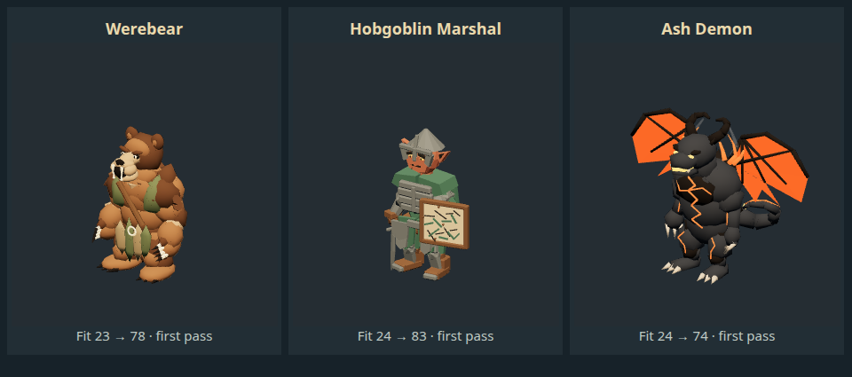

# Bear guardian, field officer and ash demon — wave 04

November 10, 2026. Base `af20959`, branch `codex/deepseek-creature-wave-04`. Bruce requested continued parallel DeepSeek batches after wave 03. These were the three lowest remaining entries after prior score overrides. Three concurrent authoring jobs completed; GPT returned concrete findings for all three. Marshal and Ash Demon incorporated the feedback before their original bounded jobs ended; Werebear completed one separate revision job. **Four actual DeepSeek calls**, not six. Organizer/author review is not independent art review.

| Creature          | Fit before → now | First-pass identity                                                                 | Triangles / materials / bones | Neutral model draw calls |
| ----------------- | ---------------- | ----------------------------------------------------------------------------------- | ----------------------------- | ------------------------ |
| Werebear          | 23 → 78          | Bear head, visible eyes/open muzzle, fur, forepaws/claws and rustic vest/strap      | 4,520 / 8 / 23                | 8                        |
| Hobgoblin Marshal | 24 → 83          | Plain steel helm, pointed ears, layered armor/green cloak, held map board and saber | 2,916 / 7 / 23                | 12                       |
| Ash Demon         | 24 → 74          | Winged charcoal body, horns, tail, ragged orange membranes, fissures/flame/soot     | 3,268 / 7 / 23                | 10                       |

[Scoped scores](audits/2026-11-10-creature-wave-04.json) use the established six-part identity rubric, not similarity percentages or final art approval. **Werebear and Ash Demon remain below the target 80**, accepted as improved recognizable coverage for the agreed first-pass stage. Bear fur is still stacked/faceted and fangs exaggerated; the demon's solid segmented body, flat wing panels/static tail and faint smoke fall short of the source's swirling animal-like fire/soot. Marshal cloth/face/armor and schematic map remain simplified. No historical full-roster scores/average are overwritten.

## Returned work

- **Werebear:** first exported front view hid its tiny eyes under a large forehead and read as a smiling teddy bear; claws were thin black spikes. Returned for exposed contrasting eyes/sockets/brow, projecting open muzzle/fangs, darker chest fur, shoulder breakup and sturdier curved claws. Revision retains the canonical rig and passes the actual unarmed attack as well as baseline poses.
- **Marshal:** first helmet read as a flat cap; armor coverage was weak and the saber looked like a short dagger. Returned for steel helmet/pauldrons/tassets and a longer curved blade with corrected grip direction. Worker used the organizer's actual pose sheets and corrected a blade-through-cuirass orientation before final review. The authored board/blade follow hand weights. Runtime suppresses the generic extra melee weapon for this model.
- **Ash Demon:** first export was brown with pale lightning-like cracks/ivory shoulder flames and clean orange wing polygons. Returned for charcoal/soot, saturated orange fissures, tapered flame tongues, notched/burned wings and thin smoke. Final review passes six actual shared poses. Smoke remains faint and fire geometry angular; it is not simulated flame or volumetric soot.

Ash Demon reuses the cosmetic heat/smoke callback, targeting actual post-lighting material instances. No gameplay light is added. Its previous boss enlargement of 1.12 is preserved when routed through the humanoid adapter. Normal and boss versions share the same authored model. IDs, rules, stats, attack effects, encounter budgets and saves are unchanged.

## Sources and reproducibility

[Provenance](creature-wave-04-provenance.json) records hashes, sources, costs and limitations. All three directly import the unchanged **CC0 KayKit Ninja** rig; visible creature/gear/material geometry is project-authored. No new downloads, paid generation or new public license for project contributions. Book/Foundry and original assets are untouched. Editable `.blend` sources and [portable builders](../scripts/toolchain/creature-workers/README.md) travel in Git; raw workers/rejected drafts/credentials stay local.

All three portable builders run in fresh Blender 5.2.4 LTS processes. Werebear/Ash Demon rebuild byte-identically. Marshal JSON, indices, positions, normals, joints, weights and binds are identical; two unused UV accessors vary by **at most 5.96e-8**, with no texture images. Do not call its GLB byte-identical. No zero-area/loose/unweighted vertices are reported; rigid overlapping body/cloth parts are intentional first-pass construction, not organic retopology. Maximum one weight influence per vertex. File/Three render meshes: 1/8, 3/12, 8/8 respectively. Transparent demon smoke adds two passes; reported costs are model-only, not total game frame cost.

The reusable `compare_asset_rig.py` now checks named joints, hierarchy, local rest data and inverse binds for every skin. All three original 23-bone skins pass: local-rest max delta about 1.10e-5, inverse-bind delta 8.35e-7. Matching names/counts alone is insufficient. A known deliberately scaled previous rig correctly fails the unfactored gate, which requires explicit presentation-scale review. This gate is structural evidence, not an anatomy/grip/deformation approval.

The demon worker's shallow file search incorrectly assumed the supplied donor was absent; the original already existed at the job-relative manifest path. It ultimately copied the matching unchanged source into a job-local input path. The accepted portable builder uses the canonical checkout path. Future contracts should give an explicit path check rather than inviting broad filesystem discovery. No original inputs were modified.

## Verification

- **358 unit tests pass**; JS/Python syntax, unchanged donor hashes and output/rebuild checks pass.
- Separate exported GLBs: front/side/back/three-quarter and actual idle/walk/slash/hit/death; Werebear/Demon additionally test `Unarmed_Melee_Attack_Punch_A`. Required clips bind, all sampled vertices are finite and poses differ. Visible-pixel checks pass independently of bounds. Final exports match the reviewed hashes.
- Actual appearance-factory capture before/after and scoped ratings validate all three. Model-only lineup above uses the real idle appearance factory at fixed game scale; source comparisons are in ignored `test-results/creature-wave-04-{before,after}/`.
- `npm run package:dir` refreshes the checkout launcher. **Muted native exact `launch-game.sh`** through terminal-matching AppArmor/SUID sandbox passes 16 visible updated creatures, baseline states, the two new actual claw attacks, existing ranged/spell/brazier checks, actual rendered heat variation and Ash boss scale. Marshal has its board/blade and no duplicate generic weapon. Inspected game screenshots show all 16 actors unobscured.
- Native suite also passes **all 58 visual adapters / 17 conditions**, isolated disk save and close handshake; space-free runtime, renderer seccomp and no `--no-sandbox` verified. Logs: `/tmp/fld-wave04-{tests,package,native}.log`.
- All four worker calls exited zero, without timeout or remaining task-owned Blender. Raw jobs/review sheets remain under `~/.local/share/four-lanterns-workers/2026-11-10-wave-04/`.

Checkout label remains **0.8.7** with the new models. Installed package/public release unchanged; no release requested. Windows packaging/desktop interaction were not run for this wave. Next lowest remaining: Hobgoblin Shieldguard, Crypt Ghoul and Ghast (26 each), checking newer work before assignment. The roster's high-end refinement remains unfinished.
