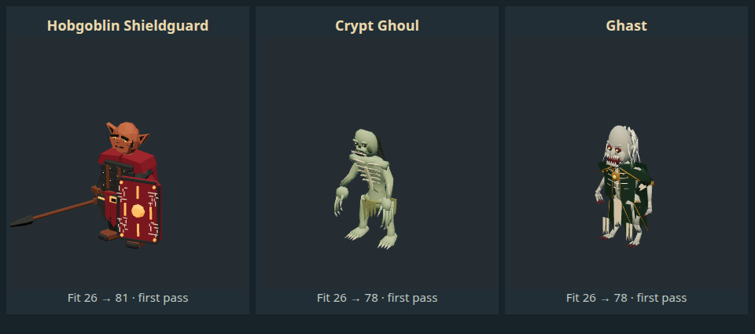

# Shieldguard, Crypt Ghoul and Ghast — wave 05

November 10, 2026. Branch `codex/deepseek-creature-wave-05`, base `428eae9`. Three concurrent DeepSeek authors, two returned Shieldguard revision calls and one returned Ghast revision call completed: **six calls total**. Crypt Ghoul incorporated organizer feedback during its original job. GPT reviewed exported geometry/poses, returned concrete findings and integrated passing first-pass models. This is organizer/author review, not independent art approval.

| Creature              | Fit before → now | Identity                                                                             | Triangles / materials / bones | Neutral draw calls |
| --------------------- | ---------------- | ------------------------------------------------------------------------------------ | ----------------------------- | ------------------ |
| Hobgoblin Shieldguard | 26 → 81          | Red-brown pointed-ear soldier, burgundy lamellar kit, tall regiment shield and spear | 3,344 / 7 / 23                | 13                 |
| Crypt Ghoul           | 26 → 78          | Bare hunched green-gray predator, ribs, skull/mouth, hooked fingers and loincloth    | 3,988 / 8 / 23                | 8                  |
| Ghast                 | 26 → 78          | Pale white-haired corpse aristocrat, tattered green/cream/gold coat and talons       | 4,416 / 8 / 23                | 8                  |

[Ratings/rationale](audits/2026-11-10-creature-wave-05.json) follow the six-part identity rubric. Undead remain below target 80: schematic ribs/skin, angular skulls, sparse hair, stiff garments and limited hunch need later refinement. Shieldguard shares the established Marshal body; armor, shield marks and grips remain simplified. Recognizable first-pass coverage is not final high-end art approval. Historical full-roster ratings/average are unchanged.

## Review and corrections

- Shieldguard's first draft retained the smiling Ninja head/headband/ponytail. Returned for actual hobgoblin anatomy and armor, using the accepted Marshal body as a permitted family donor. Second draft still held its nominally tall shield in landscape orientation. Returned again to rotate panel geometry in the actual hand-rest frame; final shared Idle reads tall, with face exposed. Spear grip/point follow the existing stab alias. Some fixed-frustum raw sheets crop the long spear tip; the inspected fitted bestiary view shows the complete weapon, and the native scene shows the entire actor/gear.
- Ghoul's first draft looked like a tidy skeleton. Returned for a curved forward thorax/head, sickly skin/creases, smaller amber eyes, projecting dark mouth/teeth and sinewy hooked hands. The final remains intentionally lean and mostly bare, distinct from Ghast's ceremonial clothes.
- Ghast's first geometry was authored arms-down against T-rest bones, causing floating hands/forearms in actual shared animations despite finite vertices and correct bone names. Returned for geometry aligned to the real canonical bone positions, connected elbows/wrists/shins, removal of invented embedded clips and replacement of a cone-like crown with skull/curved hair. Final six-pose review shows attached limbs through actual unarmed combat.

Runtime keeps the Shieldguard's authored spear/shield, suppresses generic duplicates and exempts its body name from the broad legacy `shield` mesh-hiding filter. Otherwise that name would hide its body. Rules, stats, creature IDs, attacks, encounter budgets, source book and saves are unchanged.

## Provenance and structure

[Provenance](creature-wave-05-provenance.json) contains exact reviewed hashes, donor/editable/builder paths, costs and limitations. Undead import the original CC0 KayKit Ninja rig; Shieldguard adapts the project's CC0-derived Marshal. New geometry/material/gear contributions have no new public license assignment. No paid generation or new downloaded art.

All three portable Blender 5.2.4 builders rebuild byte-identically. Canonical 23 names/parents/local rests agree within 1.10e-5. Shieldguard/Ghast inverse binds agree within 8.35e-7. Ghoul's explicitly recorded 1.16 outer presentation scale changes raw inverse binds by 0.138; after `inverseBind * presentationScale`, agreement is 8.35e-7. The comparator now supports an explicit reviewed `--presentation-scale X Y Z`; default remains strict and never infers a scale. Raw/factored deltas are separately reported. The separate renderer records the exact input SHA-256 so acceptance can be checked against a worker's changing output.

No unweighted, loose or zero-area vertices/faces reported. Max influences 1/3/2 respectively; file meshes 3/1/1 become 13/8/8 rendered primitives/calls. No texture images. Cloth seams and overlapping shells are intentional first-pass construction, not finished organic topology.

## Verification and local delivery

- 358 tests pass. An existing test still expected the superseded WerewolfMan ghoul cast; updated to the actual replacement and reran successfully. Syntax, source/review hashes and portable rebuilds pass.
- Actual exported front/side/back/three-quarter and shared idle/walk/stab-or-slash/hit/death pass visible-pixel, finite-vertex and pose-difference checks. Both undead also pass the real unarmed-punch clip. Before/after real-factory captures and scoped rating totals validated.
- Muted exact `launch-game.sh`, normal terminal AppArmor/SUID sandbox, passes 19 visible updated actors with inspected screenshots, new gear/no duplicate props, actual attacks, previous special checks, all 58 adapters/17 conditions and all 58 bestiary comparisons/control/context-cleanup checks; isolated disk save/close, seccomp and no `--no-sandbox` verified. Log `/tmp/fld-wave05-native.log`.
- Built Linux AppImage **and Debian package**. Installed the licensed current AppImage through the supported checksum-verifying installer; normal user menu now points to `~/.local/share/deep-dark-dungeons-hol/Deep-Dark-Dungeons-HoL.AppImage`, superseding the older `/opt` target. Original menu backed up under `~/.local/share/four-lanterns-install-backups/2026-11-10-wave-05/`; the system Debian package is untouched. Saves and personal sound settings untouched.
- Tested that exact installed executable with isolated saves and `--mute-audio`: all 58 bestiary entries,19 updated creatures/poses/gear, sandbox and save/close pass. Log `/tmp/fld-wave05-installed-final.log`. `DDD_NATIVE_EXECUTABLE` is an explicit installed-target option in the existing harness; ordinary tests still use `launch-game.sh`.
- Final build/test logs `/tmp/fld-wave05-{tests-final,package,install-build-final}.log`. All six worker calls exited 0, no timeout/task-owned Blender remains. Raw/rejected drafts stay local under `~/.local/share/four-lanterns-workers/2026-11-10-wave-05/`.

Local label remains 0.8.7; this is an unreleased current-source review installation. Public GitHub release unchanged. Windows packaging/desktop interaction not run for this wave. Next lowest remaining casts: Grave Wisp 33, Goblin Firestarter 35, Goblin Rattlechanter 35, but Bruce's next requested work is a **local generation/rigging pipeline pilot**. Modly/Mesh2Motion and the other suggested tools have not been installed or run; finish this wave first, then evaluate that separately. No automatic paid generation or dependency/weight downloads.
